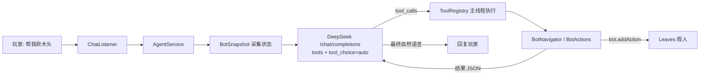

# LeavesDeepSeek

让 **DeepSeek** 接管 **LeavesMC 假人**，把假人变成服务器里属于每位玩家的 AI 小伙伴。

玩家可以直接用自然语言指挥假人：

> `@ 帮我砍三根木头，然后回到我身边`
>
> `@ 前面那只僵尸交给你了`
>
> `@ 把脚下的坑填上`

假人会自己观察环境、规划路线、切换工具、挖掘/放置方块、战斗，并在完成后用一句话汇报。

---

## 功能

- **DeepSeek Function Calling 驱动**：模型自己决定调用哪些工具、按什么顺序执行。
- **完整的玩家式操作**：`move_to` / `mine_block` / `place_block` / `attack_nearest` / `use_item` / `fish` / `sneak` / `swim` …
- **A\* 寻路 + 玩家输入**：使用 Leaves 的 `MoveAction`（前进输入）、`JumpAction`、转向，不传送、不飞行。
- **持续跟随**：主人走远时自动跟上，卡住会自动重新规划路线。
- **自动战斗**：普通敌对生物直接站撸（靠近到 3 格内停步、面向目标、每 12 tick 攻击一次，战斗时自动关闭前进/疾跑）；自动按 DPS 选武器（含附魔，耐久 <10% 跳过），有盾牌自动放副手；苦力怕进入 5 格先拉开距离，坚守者潜行离开，末影人/僵尸猪灵/狼/铁傀儡不主动攻击；血量 <30% 撤退吃金苹果，30%~60% 边打边吃，饥饿 <6 先吃；被 4 只以上围攻时撤退；战斗后自动拾取掉落物，并尽量避开边缘/水边/岩浆边。
- **AstrBot 对接**：可接入 [AstrBot OpenAPI](https://docs.astrbot.app/dev/openapi.html)，用 `/buddy astrbot say` 直接向 AstrBot 提问，模型也可以调用 `ask_astrbot` 咨询服务器规则。
- **空闲小动作**：空闲时较高频率（默认每 8 秒 35% 概率）在主人身边 2 格内随机走动。
- **挖矿自动拾取**：挖完方块会主动走近捡起掉落物，并核对 `expected / collected / missing` 数量。
- **状态持久化**：名字、位置、血量、饥饿、经验等级、背包与装备会自动保存到玩家目录，服务器重启后自动恢复假人。
- **自动进食**：饥饿值低于阈值时自动吃背包里的普通食物；金苹果、附魔金苹果、金胡萝卜等贵重食物需先征得主人同意。
- **可自定义人格**：每个玩家可用 `/buddy persona` 设置伙伴的性格与说话风格，未设置时使用全局默认。
- **状态感知**：每轮请求都会把位置、血量、背包、附近玩家/生物、视线方块等压缩成 JSON 交给模型。
- **安全边界**：活动半径限制、受保护方块、禁止攻击主人、可关闭挖掘/放置/攻击、请求限流。
- **可扩展**：新增一个工具只需要写一个 `AgentTool`（`Tools.of(...)` 一行即可）。

## 环境要求

| 项目 | 版本 |
| --- | --- |
| JDK | 25（构建用；产物通过 `--release 21` 保持对 1.21.x 服务端的兼容） |
| 服务端 | LeavesMC 1.21.8 及以上（编译目标 1.21.8，同时兼容 1.21.11 的 API 命名差异） |
| 构建 | Gradle 9.8.2（Wrapper 已内置，使用阿里云镜像） |

> 本插件依赖 Leaves 专有 API（`BotManager`、`Bot`、`BotAction`），**无法在 Paper/Purpur 上运行**。插件启动时会自动检测并给出提示。

## 构建

```powershell
.\gradlew.bat build
```

产物：`build/libs/LeavesDeepSeek-0.1.0.jar`，放入服务端 `plugins/` 目录即可。

> 构建环境由 `gradle.properties` 指定：`org.gradle.java.home=D:/Program Files/zulu25`。
> 如果你的 JDK 25 路径不同，或 `JAVA_HOME` 已指向 JDK 25，修改 / 删除该行即可。
> Gradle 发行版通过 `gradle/wrapper/gradle-wrapper.properties` 中的阿里云镜像下载。

把 jar 复制到本地开发服务器：

```powershell
.\gradlew.bat deployPlugin
```

## 本地开发服务器

```powershell
# 从 LeavesMC 官方 API 下载服务端到 run/，接受 EULA，并构建 + 复制插件
powershell -ExecutionPolicy Bypass -File .\scripts\setup-dev-server.ps1

# 启动
powershell -ExecutionPolicy Bypass -File .\run\start.ps1
```

确认 `run/leaves.yml` 中以下配置为 `true`（默认即为 `true`）：

```yaml
settings:
  modify:
    fakeplayer:
      enable: true
      use-action: true
```

## 配置

每个玩家有自己的目录：`plugins/LeavesDeepSeek/players/<uuid>/`，玩家首次进服时自动生成：

```
players/<uuid>/
├── config.yml      # 个人配置（API Key、行为开关）
├── persona.txt     # 个人人格（可选，不存在时使用全局默认）
└── bot-state.yml   # 假人状态（插件自动写入，用于重启后恢复）
```

**插件支持两种 AI 后端，玩法不同：**

| 后端 | 能力 | 配置方式 |
| --- | --- | --- |
| DeepSeek（默认） | Function Calling，可真正的操作假人 | `/buddy set <apikey> [model] [base-url]`（自动验证） |
| AstrBot | 纯对话，不能操作假人 | 玩家自己 `/buddy astrbot set <base-url> <api-key>`；管理员可用 `/buddy global astrbot set ...` 设默认 |

只有一个后端可用时会自动使用它，不需要额外设置；**两个都可用时会要求你选择默认模型**：

```text
/buddy ai set default    # 使用 DeepSeek（可操作假人）
/buddy ai set astrbot    # 使用 AstrBot（纯聊天）
/buddy ai set auto       # 恢复自动（两个都可用时仍会要求选择）
/buddy ai                # 查看当前后端与可用情况
```

选择会保存在 `players/<uuid>/config.yml` 的 `ai.backend`，默认值由服务器 `config.yml` 的 `ai.backend` 决定。

> **配置归属规则**：`plugins/LeavesDeepSeek/config.yml` 是全局配置，**只能**通过 `/buddy global ...` 修改；`/buddy set`、`/buddy astrbot ...`、`/buddy ai set`、`/buddy persona` 等只会写入 `players/<uuid>/config.yml`。

> 服务器 `config.yml` 里的 `deepseek.use-global-config`（默认 `true`）控制全局 Key 是否可以被玩家直接使用。`deepseek.api-key` 默认为空，所以默认情况下所有玩家只能用自己 `/buddy set` 的 Key；只有服主主动填入全局 Key 后，没有个人 Key 的玩家才会自动使用它。

**使用 DeepSeek 时需要一把可用的 Key（自己的，或服主开放的全局 Key）：**

```text
/buddy set <apikey> [model] [base-url]
```

- `apikey` 必填；
- `model`、`base-url` 可省略，或填 `default` 使用服务器默认值；
- **如果填写 `base-url`，必须同时填写 `model`**；
- 设置后会立即发一条最小请求验证 Key；`/buddy spawn` 和每次对话前也会自动验证一次，失败时会给出具体原因（401 Key 无效、402 余额不足、404 地址错误等）。

玩家配置文件示例：

```yaml
name: Steve
api:
  key: sk-xxxx
  model: default          # default = 使用 config.yml 的 deepseek.model
  base-url: default       # default = 使用 config.yml 的 deepseek.base-url
  validated: true
  validated-at: 0
bot:
  auto-follow: default    # true / false / default
  auto-defense: default   # 自动反击附近敌对生物
  defend-owner: default   # 主人被攻击时护主
  idle-wander: default    # 空闲随机走动
  auto-eat: default       # 饥饿时自动吃普通食物
ai:
  backend: default        # default（跟随服务器）/ deepseek / astrbot / auto
astrbot:
  enabled: default        # true / false / default（跟随全局）
  base-url: ""            # 留空则使用全局 astrbot 默认
  key: ""                 # 玩家自己的 AstrBot API Key
  session-mode: default   # default / per-player / fixed / per-message
  fixed-session: ""       # fixed 模式的会话 ID
```

人格设置保存在同一目录的 `persona.txt`（UTF-8 纯文本），未设置时回退到全局 `deepseek.extra-system-prompt`：

```text
/buddy persona set 你说话很毒舌，喜欢吐槽主人，但做事很靠谱
/buddy persona           # 查看当前人格
/buddy persona reset     # 清除个人人格，改用全局默认
```

全局默认人格写在插件目录根部的 `persona.txt`（可选，UTF-8 纯文本），或者 `config.yml` 的 `deepseek.extra-system-prompt`。
优先级：`players/<uuid>/persona.txt` → `plugins/LeavesDeepSeek/persona.txt` → `config.yml`。

```yaml
deepseek:
  extra-system-prompt: "说话简洁、有礼貌，称呼主人时会用“你”。"
```

修改后执行 `/buddy reload` 生效。

全局 `config.yml` 中还可以放一把服务器统一使用的 Key（默认留空，只有服主主动填写后才生效）：

```yaml
deepseek:
  api-key: ""              # 留空 = 不提供全局 Key
  use-global-config: true  # 允许没有个人 Key 的玩家使用上面的全局 Key
```

> 全局 Key 默认为空，所以默认行为仍然是「每个玩家用自己的 Key」。只有服主填入 `deepseek.api-key` 后，没有个人 Key 的玩家才会自动回退到全局 Key。
> 全局 Key 的验证结果缓存在 `plugins/LeavesDeepSeek/global-state.yml`，其中只保存 Key 的 SHA-256 指纹（前 12 字节），不会落盘明文。

常用配置：

```yaml
deepseek:
  model: "deepseek-chat"     # 需要 Function Calling，不要用 deepseek-reasoner
  max-tool-rounds: 8         # 一次对话最多连续调用几轮工具
  history-limit: 20          # 每个假人保留的历史消息数

ai:
  backend: auto              # auto / deepseek / astrbot（玩家可单独覆盖）

companion:
  name-prefix: "AI_"
  auto-follow: true
  follow-distance: 3.0
  skip-sleep-check: true     # 假人不参与睡眠计数，不会阻止玩家跳过夜晚

chat:
  trigger: "@"               # 仅 @ 触发模式下的前缀
  always-listen: true        # true：拥有伙伴的玩家说每句话都会发给 AI
  speak-in-chat: false       # 回复是否广播到服务器聊天栏
  log-to-console: true       # 把玩家↔假人的对话和 AI 工具调用打印到控制台

safety:
  operate-radius: 48         # 假人离开主人的最大距离
  allow-break-blocks: true
  allow-place-blocks: true
  allow-attack: true
  allow-create-bot: false
  require-leaves-for-logs: true   # 只砍带树叶的树，拒绝拆建筑
  log-leaf-radius: 5

crafting:
  enabled: true
  require-workbench: true    # 3×3 配方需要附近有工作台
  workbench-radius: 4

idle:
  enabled: true
  check-interval-seconds: 8  # 每 8 秒判定一次
  chance: 0.35               # 每次 35% 概率走动
  radius: 2.0                # 走动半径 2 格
  timeout-seconds: 4

mining:
  auto-pickup: true          # 挖完自动捡起掉落物并核对数量
  pickup-radius: 5

combat:
  auto-defense: true         # 自动反击附近敌对生物
  defense-radius: 10         # 自动索敌半径（格）
  defend-owner: true         # 主人被攻击时护主
  defend-owner-radius: 50    # 假人在主人 50 格内才会护主
  check-interval-ticks: 20
  avoid-mobs: []             # 额外不交战的生物（苦力怕/坚守者/末影人等已按类型处理）
  avoid-radius: 12           # 发现额外规避生物时多少格内开始撤退

survival:
  auto-eat: true             # 饥饿时自动吃普通食物
  eat-threshold: 14          # 饥饿值低于该值时进食
  check-interval-seconds: 5

persistence:
  enabled: true              # 保存假人状态
  interval-seconds: 30       # 定期保存间隔
  restore-on-start: true     # 服务器启动时自动恢复假人

astrbot:
  enabled: false             # 是否启用 AstrBot OpenAPI 对接
  base-url: "http://127.0.0.1:6185"
  key: ""                    # AstrBot WebUI → 设置 → OpenAPI 创建的 Key（scope 需含 chat）
  session-mode: per-player   # per-player / fixed / per-message
  fixed-session: mc-server-main
  timeout-seconds: 120       # 读取超时
  max-reply-chars: 512
```

修改后执行 `/buddy reload`。

## 对接 AstrBot（OpenAPI）

AstrBot 的 HTTP API 不是 OpenAI 协议，插件按官方文档实现了 `POST /api/v1/chat` + SSE 流式读取：

```text
MC 插件 ──POST + X-API-Key──> http://<host>:6185/api/v1/chat ──SSE──> 拼装 plain 文本 ──> 游戏聊天框
```

### 配置

1. 在 AstrBot WebUI 的 `设置 → OpenAPI` 创建一个 API Key，scope 勾选 `chat`（不要勾 `chat:admin`），key 只显示一次，立刻保存。
2. **玩家配置自己的 AstrBot（写入个人配置，优先级最高）**：

```text
/buddy astrbot set http://127.0.0.1:6185 abk_xxxxxxxx per-player
```

3. **管理员配置服务器全局默认（可选，写入插件根目录 `config.yml`）**：

```text
/buddy global astrbot set http://127.0.0.1:6185 abk_xxxxxxxx per-player
```

4. 两种命令都会自动保存并做一次连通性测试。玩家没有填的项会自动回退到全局默认；**全局配置文件只能通过 `/buddy global ...` 修改**。

| 个人命令 | 说明 |
| --- | --- |
| `/buddy astrbot` / `status` | 查看你实际使用的配置、Key（脱敏）、会话模式 |
| `/buddy astrbot set <base-url> <api-key> [session-mode]` | 写入 `players/<uuid>/config.yml` 并启用，随后自动测试 |
| `/buddy astrbot on` / `off` | 启用 / 关闭你自己的 AstrBot |
| `/buddy astrbot test` | 发送一条测试消息 |
| `/buddy astrbot say <内容>` | 以你的身份问 AstrBot，回复只发给你 |
| `/buddy astrbot session <per-player\|fixed\|per-message> [会话ID]` | 切换会话模式 |
| `/buddy astrbot clear` | 清除你自己的 Key 并关闭 |

| 全局命令（`leavesdeepseek.admin`） | 说明 |
| --- | --- |
| `/buddy global` | 查看全局配置（默认后端、全局 AstrBot、调试开关） |
| `/buddy global astrbot set <base-url> <api-key> [session-mode]` | 设置服务器全局 AstrBot 默认 |
| `/buddy global astrbot on\|off\|test\|status\|session\|clear` | 管理全局 AstrBot |
| `/buddy global ai set <auto\|deepseek\|astrbot>` | 设置全局默认 AI 后端 |
| `/buddy global debug on\|off` | 全局调试日志 |
| `/buddy global reload` | 重载全局配置 |

### 会话模式

| 模式 | session_id | 效果 |
| --- | --- | --- |
| `per-player`（默认） | `mc-<玩家名>-main` | 每个玩家独立上下文 |
| `fixed` | 个人或全局的 `fixed-session` | 所有人共用一个会话 |
| `per-message` | 不传 | 每次都是新会话，无上下文 |

- 玩家自己的 `astrbot.*` 优先，没填的项回退到服务器全局默认。
- `username` 使用 `mc-<玩家名>`，避免与 AstrBot 配置的管理员 ID 冲突（文档明确管理员 ID 会被拒绝）。
- 请求头使用 `X-API-Key: <key>`，也兼容 `Authorization: Bearer`。
- 连接超时 10 秒，读取超时由 `astrbot.timeout-seconds` 控制（默认 120 秒）；回复超过 `max-reply-chars` 会截断。
- Key 不会写入日志；`/buddy astrbot status` 与 `/buddy debug` 只显示脱敏后的值。
- 常见错误：`401 Missing/Invalid API key`（没带或 Key 错误）、`403 Insufficient API key scope`（没勾 `chat`）、`200` + `{"status":"error"}`（参数问题，例如 username 为空）。

除命令外，AI 伙伴也可以调用工具 `ask_astrbot` 咨询服务器规则（AstrBot 未配置时该工具会返回不可用）。

> AstrBot 只负责对话。把默认后端设为 AstrBot 后，伙伴仍会跟随、护主、自动进食等，但**不会执行模型指令里的挖矿/放置/战斗等工具动作**（AstrBot 无法调用本插件的工具）。需要它动手干活时请用 `/buddy ai set default` 切回 DeepSeek。

## 使用

| 命令 | 说明 |
| --- | --- |
| `/buddy set <apikey> [model] [base-url]` | 配置并验证你自己的 API Key（创建假人前必须完成） |
| `/buddy spawn [名字] [皮肤名]` | 创建你的伙伴假人 |
| `/buddy task <自然语言>` | 给伙伴下达任务（核心） |
| `/buddy say <内容>` | 让伙伴在聊天栏说话 |
| `/buddy come` | 让伙伴走过来 |
| `/buddy follow` | 持续跟随 |
| `/buddy stay` | 原地待命 |
| `/buddy listen [on\|off]` | 切换“直接接管聊天” / “仅 @ 触发” |
| `/buddy sleep` | 找到附近的床并睡觉 |
| `/buddy eat [食物]` | 让伙伴吃东西（主人命令即视为同意吃贵重食物） |
| `/buddy persona [set <描述>\|reset]` | 设置 / 查看 / 清除伙伴的人格 |
| `/buddy astrbot set <base-url> <api-key> [session-mode]` | 配置你自己的 AstrBot（写入个人配置） |
| `/buddy astrbot say <内容>` | 向 AstrBot 提问并把回复发到聊天框 |
| `/buddy global <reload\|ai\|astrbot\|debug>` | 修改全局配置（管理员） |
| `/buddy ai set <default\|astrbot\|auto>` | 选择默认 AI 后端（默认 = DeepSeek） |
| `/buddy ai` | 查看两个后端的可用情况与实际使用值 |
| `/buddy stop` | 停止全部动作 |
| `/buddy status` | 查看位置/血量/背包/动作 |
| `/buddy remove [名字]` | 移除伙伴 |
| `/buddy list` | 查看自己的伙伴 |
| `/buddy reload` | 重载配置（管理员） |
| `/buddy debug [on\|off]` | 调试信息与请求日志（管理员） |

聊天栏也可以直接对话：**默认情况下，拥有伙伴的玩家说的每句话都会发给 AI**，不需要前缀。
你的发言仍然会正常公开显示，只有伙伴的回复默认只发给你（`chat.speak-in-chat: true` 时才会广播）。
如果不想被打断，使用 `/buddy listen off` 切回仅 `@` 触发。

### 权限

| 权限 | 默认 | 说明 |
| --- | --- | --- |
| `leavesdeepseek.use` | 所有玩家 | 对话与基础功能 |
| `leavesdeepseek.spawn` | 所有玩家 | 创建/移除假人 |
| `leavesdeepseek.admin` | OP | 重载配置、调试 |

> 创建假人本身还受 Leaves 的假人功能配置限制；`/bot` 命令的权限为 `bukkit.command.bot`。

## 工作原理



- **模型调用在虚拟线程**：不阻塞服务器主线程。
- **工具执行在主线程**：每个工具返回 `CompletableFuture`，阻塞型工具（走路、挖掘）把完成信号交给调度器，主线程不会被 `sleep`。
- **超时保护**：单个工具默认 90 秒超时，避免卡死一次对话。

### 工具清单

| 工具 | 作用 |
| --- | --- |
| `get_state` / `find_block` / `find_entities` / `inspect_block` | 观察环境 |
| `move_to` / `move_to_owner` / `follow_owner` / `stop_moving` | 移动 |
| `mine_block` / `place_block` | 方块交互 |
| `attack_nearest` / `attack_player` | 战斗 |
| `get_inventory` / `switch_item` / `use_item` / `drop_item` | 背包与物品 |
| `equip_armor` | 穿盔甲：空槽位自动穿最好的，已有甲只在背包里严格更好时才换 |
| `eat` | 吃背包里的食物（贵重食物需主人同意） |
| `ask_astrbot` | 向接入的 AstrBot 咨询知识类问题（需先配置） |
| `pickup_items` | 走近捡起附近掉落物（砍树后自动执行，也可手动调用） |
| `give_item` | **直接把物品放进目标玩家背包**，不丢在地上 |
| `craft_item` / `list_craftable` | 2×2 背包合成、附近工作台的 3×3 合成 |
| `look_at` / `jump` / `sneak` / `swim` / `fish` | 姿态与动作 |
| `find_bed` / `sleep_in_bed` / `wake_up` | 找床、睡觉、起床（假人不参与睡眠计数） |
| `say` / `wait` / `stop_all_actions` | 交流与节奏控制 |
| `create_bot` / `remove_bot` | 假人管理（默认关闭） |

### 新增工具

```java
Tools.of("smelt_item", "把背包里的矿石放进熔炉烧炼", schema, (context, arguments) -> {
    // 在主线程执行，返回 CompletableFuture<String>（JSON 结果）
    return CompletableFuture.completedFuture(Json.ok("烧好了"));
});
```

## 已知限制

- **寻路**：A\* 支持台阶、下落、水面上浮，但不支持搭桥、挖隧道、跳跃 1 格空隙。复杂地形可能失败，模型会告知玩家。
- **放置方块**：需要背包里已有对应方块，且能找到可见支撑面。
- **砍树判定**：默认只有附近（5 格内）有树叶的原木才会被允许破坏，避免拆村民房子；`safety.require-leaves-for-logs: false` 可关闭。
- **合成**：已支持 2×2 背包合成和附近工作台的 3×3 合成（`craft_item`）；熔炉、铁砧、附魔台等 GUI 仍未实现。
- **给物品**：`give_item` 直接把物品放进目标玩家背包；对方背包满时物品会留在假人身上，不会掉在地上。
- **多假人**：默认每个玩家 1 个；`max-per-player` 可调大，`/buddy` 命令始终操作第一个伙伴。
- **睡觉**：假人默认不参与睡眠计数（`companion.skip-sleep-check: true`），不会导致夜晚无法跳过；`find_bed` / `sleep_in_bed` 支持让它真的躺下睡觉。
- **盔甲**：后台 `ArmorKeeper` 每 5 秒检查一次，只补**空槽位**，绝不自动升级已有装备；升级必须由主人明确要求（AI 调用 `equip_armor`）。评分规则：`保护点数 × 1000 + 材质等级 × 100 + 保护类附魔等级 × 10`，所以材质等级永远优先于附魔。换装失败会自动回滚，不会吞物品。
- **进食**：普通食物会自动吃；金苹果、附魔金苹果、金胡萝卜等贵重食物必须得到主人明确同意（对话中允许或 `/buddy eat 金苹果`）。
- **AstrBot**：按 SSE 流式读取，读取超时默认 120 秒（`ask_astrbot` 工具会使用独立超时）；回复超过 `max-reply-chars` 会截断；`username` 统一加 `mc-` 前缀，避免与 AstrBot 配置的管理员 ID 冲突。
- **AstrBot 后端**：只能对话，不能像 DeepSeek 那样调用工具操作假人；需要动手时用 `/buddy ai set default` 切回 DeepSeek。
- **对话历史**：内存保存，服务器重启后清空；假人的等级、经验、血量、背包和装备则会自动保存与恢复。
- **控制台日志**：`chat.log-to-console: true` 时，玩家与假人的对话、AstrBot 问答、AI 工具调用都会以 `[对话]` / `[AI工具]` / `[AstrBot]` 前缀打印到服务端控制台；API Key 不会打印。
- **自动战斗**：靠近到 3 格停步、面向目标、每 12 tick 攻击一次；按 DPS（伤害×攻速，含锋利）选武器，耐久 <10% 换下一把；无武器则撤退；血量 <30% 撤退吃金苹果，30%~60% 边打边吃；被 4 只以上围攻时撤退；战斗结束后自动拾取掉落物。
- **战斗禁忌**：苦力怕 ≤5 格先后退；坚守者潜行离开（不跑）；末影人、僵尸猪灵、狼、铁傀儡不主动攻击；避免站在方块边缘、水边、岩浆边战斗。

## 目录结构

```
src/main/java/com/leavesdeepseek/buddy/
├── LeavesDeepSeekPlugin.java      # 插件入口与依赖装配
├── ai/                            # DeepSeek 客户端、工具注册、Agent 循环
├── bot/                           # 假人管理、状态采集、A* 寻路、动作封装
├── tools/                         # 面向模型的工具实现
├── command/                       # /buddy 命令
├── listener/                      # 聊天触发、假人生命周期
├── config/                        # 配置快照
└── util/                          # JSON / 文本 / 调度
```
