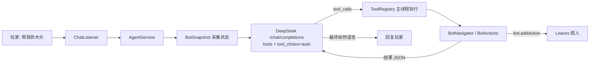

# LeavesDeepSeek

让 **DeepSeek** 接管 **LeavesMC 假人**，把假人变成服务器里属于每位玩家的 AI 小伙伴。

玩家可以直接用自然语言指挥假人：

> `@ 帮我砍三根木头，然后回到我身边`
>
> `@ 前面那只僵尸交给你了`
>
> `@ 把脚下的坑填上`

假人会自己观察环境、规划路线、切换工具、挖掘/放置方块、战斗，并在完成后用一句话汇报。

> 只是想进去和那位 AI 玩两把？直接看 [AI 躯壳 · 玩家速查](#ai-躯壳--玩家速查)。

---

## 功能

- **DeepSeek Function Calling 驱动**：模型自己决定调用哪些工具、按什么顺序执行。
- **不配 AI 也能用**：假人创建、跟随/过来/待命/睡觉/进食/护主/穿盔甲全部不依赖大模型，只有「自然语言指挥它自己干活」需要 Key。
- **完整的玩家式操作**：`move_to` / `mine_block` / `place_block` / `attack_nearest` / `use_item` / `fish` / `sneak` / `swim` …
- **A\* 寻路 + 玩家输入**：使用 Leaves 的 `MoveAction`（前进输入）、`JumpAction`、转向，不传送、不飞行。
- **持续跟随**：主人走远时自动跟上，卡住会自动重新规划路线；**跟着主人遇到苦力怕也会第一时间疾跑躲开，离开危险 5 秒后自动继续跟随**。
- **自动战斗**：15 格内的敌对生物会主动**疾跑**过去清掉（靠近到 3 格内停步、面向目标、每 12 tick 攻击一次）；自动按 DPS 选武器（含附魔，耐久 <10% 跳过），有盾牌自动放副手；**看到苦力怕（10 格内）每 0.25 秒检测一次、立刻疾跑远离、不会去打**，坚守者潜行离开，末影人/僵尸猪灵/狼/铁傀儡不主动攻击；血量 <30% 撤退并吃最好的食物（附魔金苹果最优先），30%~60% 边打边吃，饥饿 <6 先吃；**被多只怪围住时先站撸，只有血量掉到 30% 以下才持续跑开（跑到 12 格内没怪并安全 3 秒才停，被堵死角会就地反击）；被骷髅/掠夺者这类远程怪射到会立刻锁定射手冲上去，用「砍一刀退半步」的跑打方式逼近，不会站着挨箭**；战斗后自动拾取掉落物，并尽量避开边缘/水边/岩浆边。
- **水域生存**：不在跟随时掉进水里会主动找最近的岸上岸（含 1 格岸沿）；跟着主人时允许下水，但**水下快没气会先浮上来**，不会把自己憋死；寻路会优先选干路，绕不开才游泳。主人下线时同样生效（不会因为你不在就淹死）。
- **AstrBot 对接**：可接入 [AstrBot OpenAPI](https://docs.astrbot.app/dev/openapi.html)，用 `/buddy astrbot say` 直接向 AstrBot 提问，模型也可以调用 `ask_astrbot` 咨询服务器规则。
- **空闲小动作**：空闲时较高频率（默认每 8 秒 35% 概率）在主人身边 2 格内随机走动。
- **挖矿自动拾取**：挖完方块会主动走近捡起掉落物，并核对 `expected / collected / missing` 数量。
- **状态持久化**：名字、位置、血量、饥饿、经验等级、背包与装备会自动保存到玩家目录，服务器重启后自动恢复假人。
- **自动进食**：饥饿值低于阈值时自动吃背包里的普通食物；血量 **≤ 5** 时强制进食，优先吃饱食度最高的食物（附魔金苹果最优先、其次金胡萝卜/熟肉/金苹果），会直接打断战斗、寻路和 AI 任务，不需要主人同意也不经过 AI。其余情况下金苹果、附魔金苹果、金胡萝卜等贵重食物需先征得主人同意。
- **可自定义人格**：每个玩家可用 `/buddy ai persona` 设置伙伴的性格与说话风格，未设置时使用全局默认。
- **状态感知**：每轮请求都会把位置、血量、背包、附近玩家/生物、视线方块等压缩成 JSON 交给模型。
- **安全边界**：活动半径限制、受保护方块、禁止攻击主人、可关闭挖掘/放置/攻击、请求限流。
- **可扩展**：新增一个工具只需要写一个 `AgentTool`（`Tools.of(...)` 一行即可）。

## 环境要求

| 项目 | 版本 |
| --- | --- |
| JDK | 25（构建用；产物通过 `--release 21` 保持对 1.21.x 服务端的兼容） |
| 服务端 | LeavesMC 1.21.8 及以上（编译目标 1.21.8，同时兼容 1.21.11 的 API 命名差异） |
| 构建 | Gradle 9.8.2（Wrapper 已内置，使用阿里云镜像） |

> 本插件依赖 Leaves 专有 API（`BotManager`、`Bot`、`BotAction`），**无法在 Paper/Purpur 上运行**。插件启动时会自动检测并给出提示。

## 构建

```powershell
.\gradlew.bat build
```

产物：`build/libs/LeavesDeepSeek-0.1.0.jar`，放入服务端 `plugins/` 目录即可。

> AI 躯壳的 WebSocket 服务端依赖 `org.java-websocket:Java-WebSocket:1.5.6`，会被打包进这个 jar
> （`tasks.jar` 里只 zip 这一个依赖，并剔除 `META-INF/MANIFEST.MF` 与签名文件），
> 所以 jar 从 ~340KB 变成 ~620KB 是正常的，**不需要**额外安装依赖。

> 构建环境由 `gradle.properties` 指定：`org.gradle.java.home=D:/Program Files/zulu25`。
> 如果你的 JDK 25 路径不同，或 `JAVA_HOME` 已指向 JDK 25，修改 / 删除该行即可。
> Gradle 发行版通过 `gradle/wrapper/gradle-wrapper.properties` 中的阿里云镜像下载。

把 jar 复制到本地开发服务器：

```powershell
.\gradlew.bat deployPlugin
```

## 本地开发服务器

```powershell
# 从 LeavesMC 官方 API 下载服务端到 run/，接受 EULA，并构建 + 复制插件
powershell -ExecutionPolicy Bypass -File .\scripts\setup-dev-server.ps1

# 启动
powershell -ExecutionPolicy Bypass -File .\run\start.ps1
```

确认 `run/leaves.yml` 中以下配置为 `true`（默认即为 `true`）：

```yaml
settings:
  modify:
    fakeplayer:
      enable: true
      use-action: true
```

## 配置

每个玩家有自己的目录：`plugins/LeavesDeepSeek/players/<uuid>/`，玩家首次进服时自动生成：

```
players/<uuid>/
├── config.yml      # 个人配置（API Key、行为开关）
├── persona.txt     # 个人人格（可选，不存在时使用全局默认）
└── bot-state.yml   # 假人状态（插件自动写入，用于重启后恢复）
```

**插件支持两种 AI 后端，玩法不同：**

| 后端 | 能力 | 配置方式 |
| --- | --- | --- |
| DeepSeek（默认） | Function Calling，可真正的操作假人 | `/buddy ai set <apikey> [model] [base-url]`（自动验证） |
| AstrBot | 纯对话，不能操作假人 | 玩家自己 `/buddy astrbot set <base-url> <api-key>`；管理员可用 `/buddy global astrbot set ...` 设默认 |

只有一个后端可用时会自动使用它，不需要额外设置；**两个都可用时会要求你选择默认模型**：

```text
/buddy ai backend deepseek    # 使用 DeepSeek（可操作假人）
/buddy ai backend astrbot    # 使用 AstrBot（纯聊天）
/buddy ai backend auto    # 恢复自动（两个都可用时仍会要求选择）
/buddy ai status          # 查看当前后端与可用情况
```

选择会保存在 `players/<uuid>/config.yml` 的 `ai.backend`，默认值由服务器 `config.yml` 的 `ai.backend` 决定。

> **配置归属规则**：`plugins/LeavesDeepSeek/config.yml` 是全局配置，**只能**通过 `/buddy global ...` 修改；`/buddy ai set`、`/buddy astrbot ...`、`/buddy ai set`、`/buddy ai persona` 等只会写入 `players/<uuid>/config.yml`。

> 服务器 `config.yml` 里的 `deepseek.use-global-config`（默认 `true`）控制全局 Key 是否可以被玩家直接使用。`deepseek.api-key` 默认为空，所以默认情况下所有玩家只能用自己 `/buddy ai set` 的 Key；只有服主用 `/buddy global set <apikey>` 填入全局 Key 后，没有个人 Key 的玩家才会自动使用它。

**使用 DeepSeek 时需要一把可用的 Key（自己的，或服主开放的全局 Key）：**

```text
/buddy ai set <apikey> [model] [base-url]          # 玩家自己的 Key（写入 players/<uuid>/config.yml）
/buddy ai clean                                   # 清空自己的 Key/模型/地址，恢复默认值
/buddy global set <apikey> [model] [base-url]   # 服务器全局 Key（管理员，写入 config.yml）
/buddy global clean                             # 清空全局 Key/模型/地址，恢复默认值
```

- `apikey` 必填；
- `model`、`base-url` 可省略，或填 `default` 使用服务器默认值；
- **如果填写 `base-url`，必须同时填写 `model`**；
- 清空配置用 `/buddy ai clean`（个人）或 `/buddy global clean`（全局）：Key 置空、模型回到 `deepseek-chat`、地址回到 `https://api.deepseek.com`；配置项缺失或留空时同样是这三个默认值。
- 设置后会立即发一条最小请求验证 Key；`/buddy bot spawn` 和每次对话前也会自动验证一次，失败时会给出具体原因（401 Key 无效、402 余额不足、404 地址错误等）。

玩家配置文件示例：

```yaml
name: Steve
api:
  key: sk-xxxx
  model: default          # default = 使用 config.yml 的 deepseek.model
  base-url: default       # default = 使用 config.yml 的 deepseek.base-url
  validated: true
  validated-at: 0
bot:
  auto-follow: default    # true / false / default
  auto-defense: default   # 自动反击附近敌对生物
  defend-owner: default   # 主人被攻击时护主
  idle-wander: default    # 空闲随机走动
  auto-eat: default       # 饥饿时自动吃普通食物
ai:
  backend: default        # default（跟随服务器）/ deepseek / astrbot / auto
astrbot:
  enabled: default        # true / false / default（跟随全局）
  base-url: ""            # 留空则使用全局 astrbot 默认
  key: ""                 # 玩家自己的 AstrBot API Key
  session-mode: default   # default / per-player / fixed / per-message
  fixed-session: ""       # fixed 模式的会话 ID
```

人格设置保存在同一目录的 `persona.txt`（UTF-8 纯文本），未设置时回退到全局 `deepseek.extra-system-prompt`：

```text
/buddy ai persona set 你说话很毒舌，喜欢吐槽主人，但做事很靠谱
/buddy ai persona           # 查看当前人格
/buddy ai persona reset     # 清除个人人格，改用全局默认
```

全局默认人格写在插件目录根部的 `persona.txt`（可选，UTF-8 纯文本），或者 `config.yml` 的 `deepseek.extra-system-prompt`。
优先级：`players/<uuid>/persona.txt` → `plugins/LeavesDeepSeek/persona.txt` → `config.yml`。

```yaml
deepseek:
  extra-system-prompt: "说话简洁、有礼貌，称呼主人时会用“你”。"
```

修改后执行 `/buddy reload` 生效。

全局 `config.yml` 中还可以放一把服务器统一使用的 Key（默认留空，只有服主主动填写后才生效）。
管理员用命令写入即可，不需要手改文件：

```text
/buddy global set <apikey> [model] [base-url]   # 写入全局 Key 并立即验证
/buddy global clean                             # 清空全局 Key/模型/地址，恢复默认值
```

- `model` / `base-url` 不填或填 `default` 时，沿用 `config.yml` 里现有的 `deepseek.model` / `deepseek.base-url`；
- 填写 `base-url` 时必须同时填写 `model`；
- 如果 `deepseek.use-global-config` 是关闭的，设置 Key 时会自动打开（否则全局 Key 不生效，命令会提示）；
- 只有拥有 `leavesdeepseek.admin` 权限的人能用，命令只写全局 `config.yml`，玩家个人设置仍然用 `/buddy ai set`。

```yaml
# 等价于执行 /buddy global set 后 config.yml 的变化
deepseek:
  api-key: ""              # 留空 = 不提供全局 Key
  use-global-config: true  # 允许没有个人 Key 的玩家使用上面的全局 Key
```

> 全局 Key 默认为空，所以默认行为仍然是「每个玩家用自己的 Key」。只有服主填入 `deepseek.api-key` 后，没有个人 Key 的玩家才会自动回退到全局 Key。
> 全局 Key 的验证结果缓存在 `plugins/LeavesDeepSeek/global-state.yml`，其中只保存 Key 的 SHA-256 指纹（前 12 字节），不会落盘明文。

### 本地部署的模型（OpenAI 兼容接口）

把 `base-url` 指向本地服务（例如 `http://127.0.0.1:8000/v1`）、`model` 填对方提供的模型名即可。针对小模型常见的两个问题已经处理：

1. **不知道怎么控制假人**：系统提示词里会自动附上当前注册的全部工具速查表（`工具名(必填参数*, 可选参数)：说明`）、
   「主人常见说法 → 该调用哪个工具」的对照表和调用示例；
2. **不支持 Function Calling**：如果带 `tools` 的请求被服务端拒绝，插件会自动去掉 `tools` 重试一次；此时提示词要求模型
   只输出一行 `{"name":"工具名","arguments":{...}}`，插件会解析并执行（也兼容用 json 围栏包起来的写法和 `tool/args` 写法）。

如果模型连这行 JSON 都不肯输出，就只能聊天、不能操作假人了，建议换一个支持工具调用的模型。

> 推理型本地模型（R1 / QwQ 等）会把 `max_tokens` 花在 `reasoning_content` 上，容易出现「有思考、没回复、没工具调用」。
> 插件默认 `deepseek.max-tokens: 4096`；如果响应仍被截断，会自动翻倍重试一次，之后会明确提示你调大这个值。

常用配置：

```yaml
deepseek:
  model: "deepseek-chat"     # 需要 Function Calling，不要用 deepseek-reasoner
  max-tokens: 4096           # 推理型本地模型（R1/QwQ）需要更大额度，否则会被截断
  max-tool-rounds: 8         # 一次对话最多连续调用几轮工具
  history-limit: 20          # 每个假人保留的历史消息数

ai:
  backend: auto              # auto / deepseek / astrbot（玩家可单独覆盖）

companion:
  name-prefix: "AI_"
  auto-follow: false         # true：创建/唤醒假人后自动跟随主人（默认不跟随）
  follow-distance: 3.0
  skip-sleep-check: true     # 假人不参与睡眠计数，不会阻止玩家跳过夜晚

chat:
  trigger: "@"               # 仅 @ 触发模式下的前缀
  always-listen: true        # true：拥有伙伴的玩家说每句话都会发给 AI
  speak-in-chat: false       # 回复是否广播到服务器聊天栏
  log-to-console: true       # 把玩家↔假人的对话和 AI 工具调用打印到控制台

safety:
  operate-radius: 48         # 假人离开主人的最大距离
  allow-break-blocks: true
  allow-place-blocks: true
  allow-attack: true
  allow-create-bot: false
  require-leaves-for-logs: true   # 只砍带树叶的树，拒绝拆建筑
  log-leaf-radius: 5

crafting:
  enabled: true
  require-workbench: true    # 3×3 配方需要附近有工作台
  workbench-radius: 4

idle:
  enabled: true
  check-interval-seconds: 8  # 每 8 秒判定一次
  chance: 0.35               # 每次 35% 概率走动
  radius: 2.0                # 走动半径 2 格
  timeout-seconds: 4

mining:
  auto-pickup: true          # 挖完自动捡起掉落物并核对数量
  pickup-radius: 5

combat:
  auto-defense: true         # 自动反击附近敌对生物
  defense-radius: 15         # 自动索敌半径（格），这范围内的敌对生物会主动疾跑清掉
  defend-owner: true         # 主人被攻击时护主
  defend-owner-radius: 50    # 假人在主人 50 格内才会护主
  check-interval-ticks: 20
  avoid-mobs: []             # 额外不交战的生物（苦力怕/坚守者/末影人等已按类型处理：苦力怕主动远离，坚守者潜行离开）
  avoid-radius: 12           # 发现额外规避生物时多少格内开始撤退

survival:
  auto-eat: true             # 饥饿时自动吃普通食物
  eat-threshold: 14          # 饥饿值低于该值时进食
  check-interval-seconds: 5
  emergency-eat-health: 5    # 血量 ≤5 强制进食（高饱食度优先、附魔金苹果最优先，不走 AI；0 = 关闭）

persistence:
  enabled: true              # 保存假人状态
  interval-seconds: 30       # 定期保存间隔
  restore-on-start: true     # 服务器启动时自动恢复假人

astrbot:
  enabled: false             # 是否启用 AstrBot OpenAPI 对接
  base-url: "http://127.0.0.1:6185"
  key: ""                    # AstrBot WebUI → 设置 → OpenAPI 创建的 Key（scope 需含 chat）
  session-mode: per-player   # per-player / fixed / per-message
  fixed-session: mc-server-main
  timeout-seconds: 120       # 读取超时
  max-reply-chars: 512
```

修改后执行 `/buddy reload`。

## 对接 AstrBot（OpenAPI）

AstrBot 的 HTTP API 不是 OpenAI 协议，插件按官方文档实现了 `POST /api/v1/chat` + SSE 流式读取：

```text
MC 插件 ──POST + X-API-Key──> http://<host>:6185/api/v1/chat ──SSE──> 拼装 plain 文本 ──> 游戏聊天框
```

### 配置

1. 在 AstrBot WebUI 的 `设置 → OpenAPI` 创建一个 API Key，scope 勾选 `chat`（不要勾 `chat:admin`），key 只显示一次，立刻保存。
2. **玩家配置自己的 AstrBot（写入个人配置，优先级最高）**：

```text
/buddy astrbot set http://127.0.0.1:6185 abk_xxxxxxxx per-player
```

3. **管理员配置服务器全局默认（可选，写入插件根目录 `config.yml`）**：

```text
/buddy global astrbot set http://127.0.0.1:6185 abk_xxxxxxxx per-player
```

4. 两种命令都会自动保存并做一次连通性测试。玩家没有填的项会自动回退到全局默认；**全局配置文件只能通过 `/buddy global ...` 修改**。

| 个人命令 | 说明 |
| --- | --- |
| `/buddy astrbot` / `status` | 查看你实际使用的配置、Key（脱敏）、会话模式 |
| `/buddy astrbot set <base-url> <api-key> [session-mode]` | 写入 `players/<uuid>/config.yml` 并启用，随后自动测试 |
| `/buddy astrbot on` / `off` | 启用 / 关闭你自己的 AstrBot |
| `/buddy astrbot test` | 发送一条测试消息 |
| `/buddy astrbot say <内容>` | 以你的身份问 AstrBot，回复只发给你 |
| `/buddy astrbot session <per-player\|fixed\|per-message> [会话ID]` | 切换会话模式 |
| `/buddy astrbot clear` | 清除你自己的 Key 并关闭 |

| 全局命令（`leavesdeepseek.admin`） | 说明 |
| --- | --- |
| `/buddy global` | 查看全局配置（默认后端、全局 DeepSeek Key、全局 AstrBot、调试开关） |
| `/buddy global set <apikey> [model] [base-url]` | 设置服务器全局 DeepSeek Key（写入 `config.yml` 并验证） |
| `/buddy global clean` | 清空全局 Key/模型/地址并恢复默认值（Key 空、`deepseek-chat`、`https://api.deepseek.com`） |
| `/buddy global astrbot set <base-url> <api-key> [session-mode]` | 设置服务器全局 AstrBot 默认 |
| `/buddy global astrbot on\|off\|test\|status\|session\|clear` | 管理全局 AstrBot |
| `/buddy global ai set <auto\|deepseek\|astrbot>` | 设置全局默认 AI 后端 |
| `/buddy global debug on\|off` | 全局调试日志 |
| `/buddy global reload` | 重载全局配置 |

### 会话模式

| 模式 | session_id | 效果 |
| --- | --- | --- |
| `per-player`（默认） | `mc-<玩家名>-main` | 每个玩家独立上下文 |
| `fixed` | 个人或全局的 `fixed-session` | 所有人共用一个会话 |
| `per-message` | 不传 | 每次都是新会话，无上下文 |

- 玩家自己的 `astrbot.*` 优先，没填的项回退到服务器全局默认。
- `username` 使用 `mc-<玩家名>`，避免与 AstrBot 配置的管理员 ID 冲突（文档明确管理员 ID 会被拒绝）。
- 请求头使用 `X-API-Key: <key>`，也兼容 `Authorization: Bearer`。
- 连接超时 10 秒，读取超时由 `astrbot.timeout-seconds` 控制（默认 120 秒）；回复超过 `max-reply-chars` 会截断。
- Key 不会写入日志；`/buddy astrbot status` 与 `/buddy debug` 只显示脱敏后的值。
- 常见错误：`401 Missing/Invalid API key`（没带或 Key 错误）、`403 Insufficient API key scope`（没勾 `chat`）、`200` + `{"status":"error"}`（参数问题，例如 username 为空）。

除命令外，AI 伙伴也可以调用工具 `ask_astrbot` 咨询服务器规则（AstrBot 未配置时该工具会返回不可用）。

> AstrBot 只负责对话。把默认后端设为 AstrBot 后，伙伴仍会跟随、护主、自动进食等，但**不会执行模型指令里的挖矿/放置/战斗等工具动作**（AstrBot 无法调用本插件的工具）。需要它动手干活时请用 `/buddy ai backend deepseek` 切回 DeepSeek。

> **没有 AI 也能用**：`/buddy bot spawn` 不再强制要求 Key。没有可用的 DeepSeek / AstrBot 时，假人照样能创建、
> 护主、自动进食、穿盔甲，也可以用 `/buddy move follow`、`/buddy move come`、`/buddy move stay`、
> `/buddy move sleep`、`/buddy do eat`、`/buddy status` 等命令直接操作；只是不能通过自然语言指挥它自己干活。
> 创建后默认**不会**自动跟随（`companion.auto-follow: false`），需要时 `/buddy move follow` 或说「跟着我」。
> 配好 Key 后无需重新创建假人，聊天功能会立即生效。

## 使用

命令按用途分成四组：**假人本体** `/buddy bot`、**移动** `/buddy move`、**做事** `/buddy do`、**AI 配置** `/buddy ai`
（另有 `/buddy astrbot`、管理员用的 `/buddy global`）。`/buddy help` 会列出全部。

**假人** — `/buddy bot <spawn|remove|list|revive|info>`

| 命令 | 说明 |
| --- | --- |
| `/buddy bot spawn [名字] [皮肤名]` | 创建你的伙伴假人（不需要先配 AI） |
| `/buddy bot remove [名字]` | 移除伙伴 |
| `/buddy bot list` | 查看自己的伙伴 |
| `/buddy bot revive` | 把倒下的伙伴救起来（物品一件不丢；不在线时从存档唤醒） |
| `/buddy bot info` | 查看位置/血量/背包/动作（等同 `/buddy status`） |

**移动** — `/buddy move <follow|come|stay|stop|sleep>`

| 命令 | 说明 |
| --- | --- |
| `/buddy move follow` | 持续跟随 |
| `/buddy move come` | 让伙伴走过来 |
| `/buddy move stay` | 原地待命（等同关闭跟随） |
| `/buddy move stop` | 停止全部动作并关闭跟随（重新跟上：说「跟着我」或 `/buddy move follow`） |
| `/buddy move sleep` | 找到附近的床并睡觉 |

**做事** — `/buddy do <task|say|eat|listen>`

| 命令 | 说明 |
| --- | --- |
| `/buddy do task <自然语言>` | 给伙伴下达任务（核心） |
| `/buddy do say <内容>` | 让伙伴在聊天栏说话 |
| `/buddy do eat [食物]` | 让伙伴吃东西（主人命令即视为同意吃贵重食物） |
| `/buddy do listen [on\|off]` | 切换“直接接管聊天” / “仅 @ 触发” |

**AI** — `/buddy ai <set|clean|backend|status|persona>`

| 命令 | 说明 |
| --- | --- |
| `/buddy ai set <apikey> [model] [base-url]` | 配置并验证你自己的 API Key（不配也能用命令操作假人） |
| `/buddy ai clean` | 清空你自己的 Key / 模型 / 地址（恢复默认值） |
| `/buddy ai backend <auto\|deepseek\|astrbot>` | 选择默认 AI 后端（默认 = DeepSeek） |
| `/buddy ai status` | 查看两个后端的可用情况与实际使用值 |
| `/buddy ai persona [set <描述>\|reset]` | 设置 / 查看 / 清除伙伴的人格 |

**AstrBot** — `/buddy astrbot <set|on|off|test|status|session|clear|say>`

| 命令 | 说明 |
| --- | --- |
| `/buddy astrbot set <base-url> <api-key> [session-mode]` | 配置你自己的 AstrBot（写入个人配置） |
| `/buddy astrbot say <内容>` | 向 AstrBot 提问并把回复发到聊天框 |

**管理员**

| 命令 | 说明 |
| --- | --- |
| `/buddy global set <apikey> [model] [base-url]` | 配置服务器全局 DeepSeek Key |
| `/buddy global clean` | 清空全局 Key / 模型 / 地址（恢复默认值） |
| `/buddy global <reload\|ai\|astrbot\|debug>` | 修改其他全局配置 |
| `/buddy reload` | 重载配置 |
| `/buddy debug [on\|off]` | 调试信息与请求日志 |
| `/buddy status` | 查看位置/血量/背包/动作 |
| `/buddy help` | 查看全部分组命令 |

> 旧版的 `/buddy follow`、`/buddy spawn`、`/buddy ai set` 等**扁平命令已移除**，请改用上表的新结构：
> `/buddy bot …`（假人本体）、`/buddy move …`（移动跟随）、`/buddy do …`（做事说话）、`/buddy ai …`（模型与 Key）。

聊天栏也可以直接对话：**默认情况下，拥有伙伴的玩家说的每句话都会发给 AI**，不需要前缀。
你的发言仍然会正常公开显示，只有伙伴的回复默认只发给你（`chat.speak-in-chat: true` 时才会广播）。
如果不想被打断，使用 `/buddy do listen off` 切回仅 `@` 触发。

> 「跟着我」「过来」「停下」「复活」这几类短句由**插件直接执行**，不经过大模型，也不需要配置 AI：
> 说「停下」等同于执行 `/buddy move stop`（打断挖掘/战斗/砍树 + 关闭跟随）；说「跟着我」等同于 `/buddy move follow`；
> 说「过来」等同于 `/buddy move come`；说「复活」等同于 `/buddy bot revive`。
> 「跟着我」是最高优先级：假人会立刻放下手上的活（唯一例外是血量危急时的强制进食，吃完会立刻跟上）。

### 死亡与复活

假人受到致命伤时**不会真的死亡、不会掉落任何物品**：

1. 插件拦下死亡（`BotDeathEvent`），假人进入「倒地」状态：保留背包与全部装备、免疫伤害、停止所有动作；
2. 主人会在聊天里收到提示，说「**复活**」或执行 `/buddy bot revive` 即可救起；
3. 复活时回满血、传送到主人身边（距离 32 格内则原地起来），倒地前正在跟随的会自动继续跟；
4. 倒地状态会写进 `bot-state.yml`，服务器重启后仍然是倒地状态，需要再次复活；如果假人已不在线，`/buddy bot revive` 会尝试从存档重新生成。

> 旧版本「死亡时装备掉一地、重启后存档又恢复一套」的问题，现在从源头被拦住：死亡根本不发生，也就不存在第二份掉落物。

### 权限

| 权限 | 默认 | 说明 |
| --- | --- | --- |
| `leavesdeepseek.use` | 所有玩家 | 对话与基础功能 |
| `leavesdeepseek.spawn` | 所有玩家 | 创建/移除假人 |
| `leavesdeepseek.admin` | OP | 重载配置、调试 |

> 创建假人本身还受 Leaves 的假人功能配置限制；`/bot` 命令的权限为 `bukkit.command.bot`。

## AI 躯壳 · 玩家速查

> 给来帮忙测 bug 的朋友：**不用装任何东西**，进服、说话就行。

服务器里那个叫 **Whalien** 的假人背后不是脚本，是一个会自己看、自己走、自己反应的 AI。
它有三个名字，随便叫：**Whalien / 沈知潮 / 潮水**。

### 怎么跟它交流

直接在聊天框说话，它看得见：

| 你说 | 它会 |
| --- | --- |
| 跟我 / 跟上 / 过来 / 回来 | 走向你，停在 2~3 格外，不会贴脸 |
| 停 / 别动 / 站住 / 等我 | 立刻停下 |
| 逛 / 转转 / 随便走 | 在你附近 20 格内随机溜达 |
| 带问号的句子 | 会回一句（现在还很笨） |

它话不多，别指望它陪你聊天；目前更擅长「做事」而不是「说话」。

### 它能做什么

```
跟随    跟到 2~3 格停住
移动    会绕简单障碍走到指定坐标
吃      饿了自己吃（不吃贵重食物，除非血量很低）
打      被怪贴身会还手（打不过会跑）
看      能看见你的位置、血量、手持物、游戏模式
背包    看得见自己全部物品，包括自定义名与附魔
```

**还不太会**：合成、造房子、整理箱子、长距离跨地形赶路、复杂地形挖矿。

### 请这样带它玩

```
✔  带它散步、跟着你逛村子
✔  丢东西在地上，它会捡
✔  带它打怪，看它会不会帮忙
✔  故意走远一点，看它跟不跟得上
✘  别用 TNT / 岩浆烧它（会死，死了要重养）
✘  别一直拿剑砍它（测一两下就够）
✘  别把它推下悬崖，也别用管理命令瞬移它
```

### 报 bug 按这个格式（时间 / 你做了什么 / 它做了什么）

```
时间      20:35 左右
我说的    "跟我来"
我做的    从房子走到村口，大约 30 格
它做的    跟到一半停在原地，然后左右抖了十几秒
我期望    它应该跟到村口
截图/录像  有就最好
```

只写「它卡住了」是查不出来的。

### 已知问题（不用重复报）

| 现象 | 原因 | 状态 |
| --- | --- | --- |
| 刚上线时它不知道背包里有什么 | 背包基线在 attach 前就被写掉了 | 已改：attach 后强制推一帧 `full:true`（待验证） |
| 打它一下伤害记两次 | 事件推送 + 血量兜底重复计数 | 已改：500ms 去重，字段统一为 `amount/cause/source/hpAfter/pos` |
| 没连上时它会自己慢慢走开 | 粘性跟随在旁观态被看门狗接回去 | 已改：躯壳取消/暂停任务时清掉跟随状态 |
| 说话很笨，只会回「听见了」 | 对话侧还在做 | 计划中 |

## AI 躯壳（外部机器人接管）

除了「有自己 AI 的伙伴假人」，插件还能造**躯壳**：一具完全交给外部机器人控制的生存玩家。
躯壳不跟随、不护主、不闲聊、不自动决策——它只做外部 AI 下发的动作，感知数据按固定频率推回去。

```powershell
# 1) config.yml：打开躯壳服务（默认关闭）
agent:
  enabled: true
  bind: "127.0.0.1"   # 强烈建议保持只绑本机
  port: 8123
  token: ""           # 留空 = 默认 "leavesdeepseek"（插件名小写）；对外开放前请改成随机串
  allow-create: true  # AI 能不能通过 body.create 自己造躯壳
  allow-delete: false # AI 能不能删躯壳（只能删自己造的；默认关）
```

```text
# 2) 造躯壳（仅 OP）
/ai body create Whalien                  # 在当前位置
/ai body create Whalien world 120 70 -300
/ai body list
/ai body info Whalien
/ai body remove Whalien --save
/ai body take Whalien                    # 踢掉当前控制会话
/ai body move Whalien 120 70 -300        # 卡地形救场
/ai body anchor Whalien set|clear        # 死亡重生点
/ai body config Whalien allow-pvp true   # 单躯壳覆盖配置
```

```text
# 3) 外部机器人连上来（WebSocket + JSON-RPC 2.0）
ws://127.0.0.1:8123/agent
{"jsonrpc":"2.0","id":0,"method":"auth","params":{"token":"<agent.token>"}}
{"jsonrpc":"2.0","id":1,"method":"body.attach","params":{"name":"Whalien"}}
{"jsonrpc":"2.0","id":2,"method":"sense.snapshot"}
{"jsonrpc":"2.0","id":3,"method":"act.goto","params":{"x":120,"y":70,"z":-300}}

# 也可以让 AI 自己造躯壳（不需要先 attach）
{"jsonrpc":"2.0","id":4,"method":"body.list"}
{"jsonrpc":"2.0","id":5,"method":"body.create","params":{"name":"Whalien"}}
```

- 躯壳生命周期（**不需要 attach 就能调**）：`body.list`（全部躯壳 + `mine` 标记）、
  `body.create`（`name` / `x,y,z` / `world` / `autoAttach=true`）、`body.delete`（只能删自己造的）。
  是否允许 AI 造/删由 `agent.allow-create`（默认 true）与 `agent.allow-delete`（默认 **false**）控制；
  归属按 token 指纹判断（`body.create` 造的才有 owner），没有 owner 的老躯壳只能由管理员删。

- 感知：`sense.snapshot / terrain / entity / item / blockAt / blocks / findBlock / player / canReach`，
  另有 5 Hz 的 `t:"M"`（运动）、`t:"T"`（地形语义）、`t:"P"`（附近玩家）、`t:"K"`（任务）、
  背包变化时的 `t:"I"`。
- 动作：`act.goto / follow / look / attack / dig / digArea / place / craft / container / use / equip /
  eat / drop / jump / sneak / sprint / chat / cancel / queue`，统一返回 `taskId`，进度和结果用
  `task.started / task.progress / task.done / task.failed` 事件推回。
- 事件：`ev.damage / death / respawn / playerNear / playerLeave / chat / itemPickup / hungry / state`。
- 三态：90 秒没有请求自动切成**旁观**（`paused`，不受伤也不能动作），再 300 秒存档下线（`offline`）；
  重新 `body.attach` 会原地恢复（背包/经验/血量都在）。
- 安全：只绑本机 + token 鉴权 + 每秒动作/感知限速 + 受保护方块 + 操作半径 + TPS 保护 + 审计日志
  （`plugins/LeavesDeepSeek/bodies/audit-YYYY-MM-DD.jsonl`）。

> 完整协议（所有字段、错误码 `-32001…-32021`、验收清单）见仓库根目录的 [`ai_body_SPEC.md`](ai_body_SPEC.md)。
> 躯壳的存档在 `plugins/LeavesDeepSeek/bodies/<名字>/state.yml`，与传统假人的 `players/<uuid>/` 完全分开。
> 联调资料（客户端、模拟服务端、验收文档）在 [`AI_DOCS/`](AI_DOCS/)：`ai_body_SPEC.md`、`ai_body_DELIVERY.md`、
> `ai_body_FIX_REQUEST_v1.md`、`ai_body_PLAYER_GUIDE.md`。

**目前一个连接只能挂一个躯壳**；多个躯壳要开多个连接（`agent.max-bodies-per-session` 默认 1）。

## 工作原理



- **模型调用在虚拟线程**：不阻塞服务器主线程。
- **工具执行在主线程**：每个工具返回 `CompletableFuture`，阻塞型工具（走路、挖掘）把完成信号交给调度器，主线程不会被 `sleep`。
- **超时保护**：单个工具默认 90 秒超时，避免卡死一次对话。

### 工具清单

| 工具 | 作用 |
| --- | --- |
| `get_state` / `find_block` / `find_entities` / `inspect_block` | 观察环境 |
| `move_to` / `move_to_owner` / `follow_owner` / `stop_moving` | 移动 |
| `mine_block` / `place_block` | 方块交互 |
| `attack_nearest` / `attack_player` | 战斗 |
| `get_inventory` / `switch_item` / `use_item` / `drop_item` | 背包与物品 |
| `equip_armor` | 穿盔甲：空槽位自动穿最好的，已有甲只在背包里严格更好时才换 |
| `eat` | 吃背包里的食物（贵重食物需主人同意） |
| `ask_astrbot` | 向接入的 AstrBot 咨询知识类问题（需先配置） |
| `pickup_items` | 走近捡起附近掉落物（砍树后自动执行，也可手动调用） |
| `give_item` | **直接把物品放进目标玩家背包**，不丢在地上 |
| `craft_item` / `list_craftable` | 2×2 背包合成、附近工作台的 3×3 合成 |
| `look_at` / `jump` / `sneak` / `swim` / `fish` | 姿态与动作 |
| `find_bed` / `sleep_in_bed` / `wake_up` | 找床、睡觉、起床（假人不参与睡眠计数） |
| `say` / `wait` / `stop_all_actions` | 交流与节奏控制 |
| `create_bot` / `remove_bot` | 假人管理（默认关闭） |

### 新增工具

```java
Tools.of("smelt_item", "把背包里的矿石放进熔炉烧炼", schema, (context, arguments) -> {
    // 在主线程执行，返回 CompletableFuture<String>（JSON 结果）
    return CompletableFuture.completedFuture(Json.ok("烧好了"));
});
```

## 已知限制

- **寻路**：A\* 支持台阶、下落、水面上浮，但不支持搭桥、挖隧道、跳跃 1 格空隙。复杂地形可能失败，模型会告知玩家。
- **放置方块**：需要背包里已有对应方块，且能找到可见支撑面。
- **砍树判定**：默认只有附近（5 格内）有树叶的原木才会被允许破坏，避免拆村民房子；`safety.require-leaves-for-logs: false` 可关闭。
- **合成**：已支持 2×2 背包合成和附近工作台的 3×3 合成（`craft_item`）；熔炉、铁砧、附魔台等 GUI 仍未实现。
- **给物品**：`give_item` 直接把物品放进目标玩家背包；对方背包满时物品会留在假人身上，不会掉在地上。
- **多假人**：默认每个玩家 1 个；`max-per-player` 可调大，`/buddy` 命令始终操作第一个伙伴。
- **睡觉**：假人默认不参与睡眠计数（`companion.skip-sleep-check: true`），不会导致夜晚无法跳过；`find_bed` / `sleep_in_bed` 支持让它真的躺下睡觉。
- **盔甲**：后台 `ArmorKeeper` 每 5 秒检查一次，只补**空槽位**，绝不自动升级已有装备；升级必须由主人明确要求（AI 调用 `equip_armor`）。评分规则：`保护点数 × 1000 + 材质等级 × 100 + 保护类附魔等级 × 10`，所以材质等级永远优先于附魔。换装失败会自动回滚，不会吞物品。
- **进食**：普通食物会自动吃；金苹果、附魔金苹果、金胡萝卜等贵重食物必须得到主人明确同意（对话中允许或 `/buddy do eat 金苹果`）。例外：血量 ≤ `survival.emergency-eat-health`（默认 5）时会强制进食，优先高饱食度食物（附魔金苹果最优先），无需同意、不经过 AI。
- **AstrBot**：按 SSE 流式读取，读取超时默认 120 秒（`ask_astrbot` 工具会使用独立超时）；回复超过 `max-reply-chars` 会截断；`username` 统一加 `mc-` 前缀，避免与 AstrBot 配置的管理员 ID 冲突。
- **AstrBot 后端**：只能对话，不能像 DeepSeek 那样调用工具操作假人；需要动手时用 `/buddy ai backend deepseek` 切回 DeepSeek。
- **对话历史**：内存保存，服务器重启后清空；假人的等级、经验、血量、背包和装备则会自动保存与恢复。
- **控制台日志**：`chat.log-to-console: true` 时，玩家与假人的对话、AstrBot 问答、AI 工具调用都会以 `[对话]` / `[AI工具]` / `[AstrBot]` 前缀打印到服务端控制台；API Key 不会打印。
- **自动战斗**：靠近到 3 格停步、面向目标、每 12 tick 攻击一次；按 DPS（伤害×攻速，含锋利）选武器，耐久 <10% 换下一把；无武器则撤退；血量 <30% 撤退吃金苹果，30%~60% 边打边吃；**被多只怪围住时先站撸，血量掉到 30% 以下才持续跑开**（跑到 12 格没怪并安全 3 秒才停，被堵死角就地反击）；**被骷髅/掠夺者这类远程怪打中会立刻锁定射手冲上去，用「砍一刀退半步」的跑打方式逼近**；战斗结束后自动拾取掉落物。
- **战斗禁忌**：看到苦力怕（10 格内）就疾跑远开、绝不近战；坚守者潜行离开（不跑）；末影人、僵尸猪灵、狼、铁傀儡不主动攻击；避免站在方块边缘、水边、岩浆边战斗。
- **AI 躯壳**：`act.craft` 的 3×3 配方要求半径 4 格内有工作台（否则 `-32017`）；`act.container` 默认禁用；`sense.terrain` 的地标/危险是半径 8 采样；`act.queue` 的 `elapsedMs` 是任务真实运行时长，`etaMs` 算不出来时给 `-1`；躯壳的跟随是「一次性任务」，进到 `distance+0.5` 内稳定 10 tick 就结束，需要持续跟随时由外部 AI 重新下发。

## 目录结构

```
src/main/java/com/leavesdeepseek/buddy/
├── LeavesDeepSeekPlugin.java      # 插件入口与依赖装配
├── ai/                            # DeepSeek 客户端、工具注册、Agent 循环
├── bot/                           # 假人管理、状态采集、A* 寻路、动作封装
├── tools/                         # 面向模型的工具实现
├── command/                       # /buddy 命令
├── listener/                      # 聊天触发、假人生命周期
├── config/                        # 配置快照
└── util/                          # JSON / 文本 / 调度

src/main/java/com/leavesdeepseek/agent/   # AI 躯壳（独立子系统，对外 WebSocket）
├── AgentServer / AgentSession     # WS + JSON-RPC + 限速
├── BodyManager / AIBody           # 躯壳注册表与三态
├── BodyController                 # 20 Hz 内环（任务队列 / 自动进食 / 捡物 / 卡住自愈）
├── SensorHub                      # sense.* 与 M/I/T/P/K 推送帧、ev.* 事件
├── SpectatorGuard / BodyStore     # 心跳旁观、bodies/<name>/state.yml
├── task/                          # goto/follow/look/attack/dig/place/craft/...
└── command/AICommand              # /ai body ...
```
